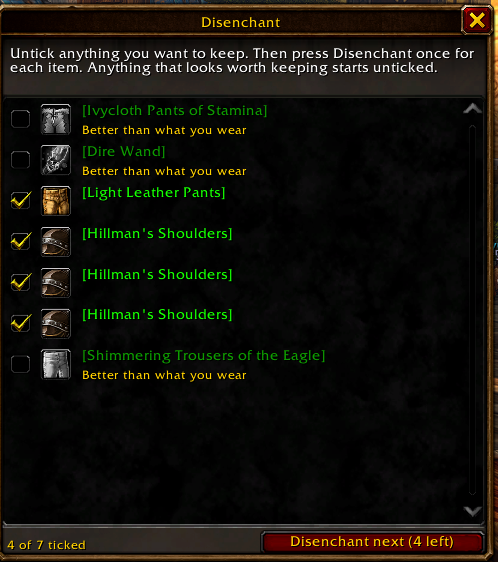

# Encore

Two small helps for enchanters in World of Warcraft: Forever. Put the same
enchant on again without the "replace the existing enchant?" prompt, and
disenchant what you don't need from a list of your bags.

**What's in it**

- **Enchant, skip confirm:** a button beside the Enchanting window's
  Enchant button. One press casts the enchant and says Yes to replacing
  the old one.
- **Disenchant All...:** lists the gear in your bags that can be
  disenchanted. Untick what you want to keep, then press Disenchant next
  once for each item.
- **Running total:** the dust, essences and shards gained so far, with an
  auction value if you have Gold Wise.
- **Careful by default:** gear you've worn, gear in an equipment set,
  upgrades, rare and epic items, and anything on your Gold Wise Keep list
  start unticked, with the reason shown.
- **Key bindings** for both buttons, under Options > Keybindings > Encore.

**Getting started**

Open Enchanting, pick an enchant and put the item in its slot: the Enchant,
skip confirm button appears. For the disenchant list, press Disenchant
All... in the same window, or type `/encore`.

**Notes**

- The game needs a key press or click for every cast, so it's one press
  per enchant or disenchant. Encore saves the clicks in between.
- It never answers the prompt that asks to make an item soulbound.
- Upgrades are judged by ItemTree if you have it, otherwise by item level.
- Found a bug? Open an issue on
  [GitHub](https://github.com/flightpathlabs/Encore/issues).

Encore is a fan-made addon, not affiliated with Blizzard Entertainment.

MIT licence, see [LICENSE](LICENSE). Changes are in the
[changelog](CHANGELOG.md). AI tooling is used openly in making this
addon; everything is reviewed and tested in game before release.

**More from Flight Path Labs**

Small addons for World of Warcraft: Forever, all at
[github.com/flightpathlabs](https://github.com/flightpathlabs).

- [Gold Wise](https://github.com/flightpathlabs/GoldWise): auction prices for what you carry, and what's worth doing with it.
- [Creel](https://github.com/flightpathlabs/Creel): a fishing log and one-key cast.
- [Temper](https://github.com/flightpathlabs/Temper): how your character fights, and whether a change helped. Coming soon.
